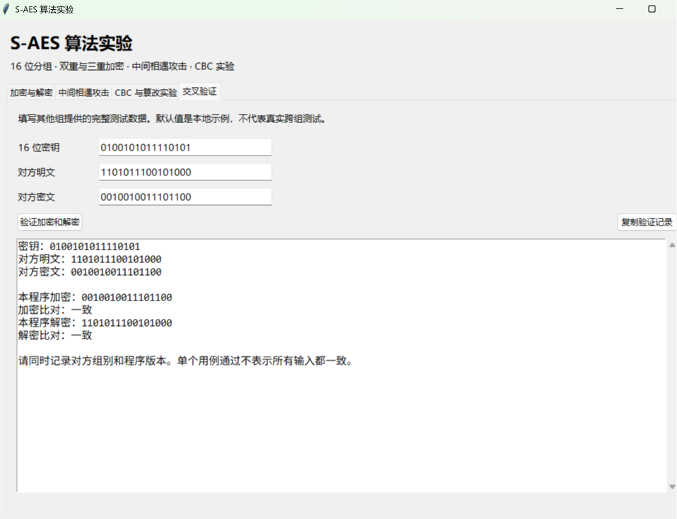
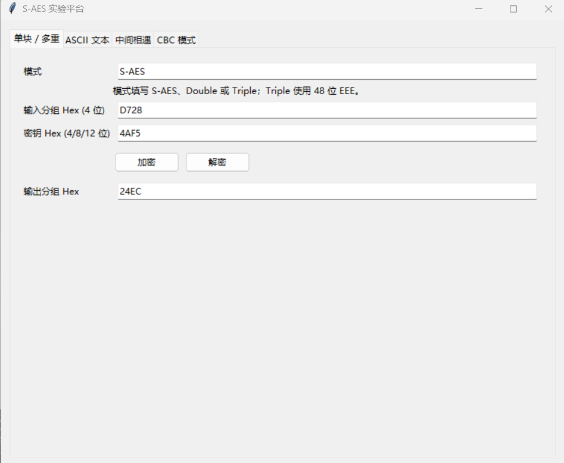
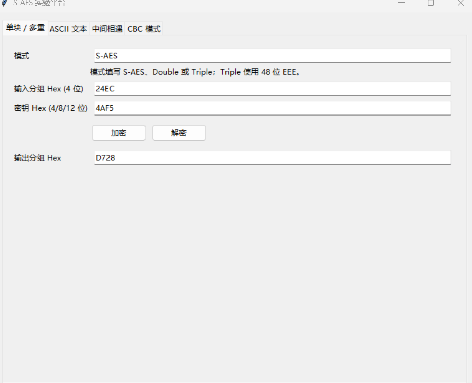

# 第 2 关：组间交叉测试报告

本组成员：扶满（20245177）、蔡旭涛（20240947）。本组程序为 Python/Tkinter 实现的 S-AES 实验平台。2026 年 10 月 26 日收录了外组同学的“交叉验证”页面截图，以及本组程序的加密、解密截图。

## 算法与输入约定

本组按教材附录 D 实现 16 位分组、16 位密钥的 S-AES。状态中的四个半字节 `n0n1n2n3` 按列排成 `[[n0,n2],[n1,n3]]`；S 盒为 `9 4 A B / D 1 8 5 / 6 2 0 3 / C E F 7`；GF(2⁴) 的模多项式为 `x⁴+x+1`；正向列混淆矩阵为 `[[1,4],[4,1]]`，逆矩阵为 `[[9,2],[2,9]]`；密钥扩展轮常数为 `80`、`30`。详细逐组件参考值见 [组件测试记录](component_cross_test.md)。

本次组间测试使用原始 S-AES 单块模式，未使用 CBC、填充或多重加密。双方采用相同数值：

| 项目 | 二进制 | 十六进制 |
| --- | --- | --- |
| 密钥 K | `0100101011110101` | `4AF5` |
| 明文 P | `1101011100101000` | `D728` |
| 密文 C | `0010010011101100` | `24EC` |

## 运行结果

| 程序 | 加密 `E(K,P)` | 解密 `D(K,C)` | 截图 |
| --- | --- | --- | --- |
| 外组同学的 S-AES 算法实验程序 | `24EC` | `D728` | 图 1 |
| 本组 S-AES 实验平台 | `24EC` | `D728` | 图 2、图 3 |

两套程序在这一组输入下的加密结果相同；本组密文交给外组程序解密、外组程序生成的相同密文交给本组程序解密，均恢复明文 `D728`。因此，本次截图支持**该测试向量的组间加解密一致**。

### 图 1：外组程序的交叉验证

### 图 2：本组程序加密

### 图 3：本组程序解密

## 证据范围

外组程序页面注明这组值为默认示例。现有截图能够证明该向量上的输出一致，但未展示新选向量的结果；也未包含外组程序的源码、语言版本或操作系统信息。因此本报告只对已截图的一组结果作结论，不将其写作逐组件源码核验或跨平台验证。
